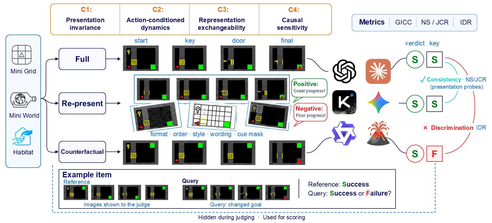

<h1 align="center">
  Towards Reliable VLM Judges:<br>
  State-Conditional Invariance and Presentation-Aware Diagnostics
</h1>

<div align="center">
  <p>
    <a href="https://openreview.net/profile?id=~Qinan_Zhang2">Qinan Zhang<sup>*</sup></a>,
    <a href="https://openreview.net/profile?id=~Xinyu_Wang65">Xinyu Wang<sup>*</sup></a>,
    <a href="https://openreview.net/profile?id=~Qihang_Jin1">Qihang Jin<sup>*</sup></a>,
    <br>
    <a href="https://openreview.net/profile?id=~Tianyuan_Wang2">Tianyuan Wang</a>,
    <a href="https://openreview.net/profile?id=~Jian_Di1">Jian Di</a>,
    <a href="https://openreview.net/profile?id=~Hongbing_Luo1">Hongbing Luo</a>,
    <a href="https://openreview.net/profile?id=~Pengfei_Li24">Pengfei Li</a>,
    <a href="https://openreview.net/profile?id=~Wenjun_Lv1">Wenjun Lv</a>,
    <a href="https://openreview.net/profile?id=~Yu_Kang5">Yu Kang</a>
  </p>
  <p><sup>*</sup> Equal contribution (co-first authors).</p>
  <p>University of Science and Technology of China</p>
  <p><strong>NeurIPS 2026 Evaluations and Datasets Track</strong></p>
  <p>
    
    <a href="https://xinyuw922-pixel.github.io/aa/"></a>
    <a href="https://huggingface.co/datasets/nahco318/Towards-Reliable-VLM-Judges"></a>
  </p>
</div>

<p align="center">
  
</p>

<p align="center"><em>GridWM-Judge: aligned trajectories, presentation probes, and counterfactual judgments.</em></p>

<details>
<summary>Abstract</summary>

Vision-language models (VLMs) are increasingly used as automated judges for multimodal and embodied tasks, yet aggregate accuracy or consistency alone does not reveal whether a judge changes its verdict for the right reason. We propose State-Conditional Invariance (SCI), a reliability principle requiring a judge to remain stable under semantics-preserving presentation changes while responding to causal interventions that change the task outcome. We instantiate SCI in GridWM-Judge, a simulator-grounded diagnostic benchmark built from deterministic MiniGrid trajectories with aligned Full, evidence-removal, and counterfactual variants, plus presentation and representation probes. Across five diagnostic tasks, GridWM-Judge tests local perception, action-conditioned transitions, presentation stability, representation exchangeability, and Full-CF causal discrimination. Evaluating current VLM judges reveals separable failures, including presentation sensitivity, representation fragility, causal misgrounding, action-insensitive heuristics, and stability traps. These results show that reliable VLM-as-a-judge evaluation requires joint reporting of correctness, presentation invariance, and causal sensitivity rather than a single accuracy or consistency score.

</details>

## Overview

| Dataset | Tasks | Formal Questions |
| --- | --- | --- |
| MiniGrid | A/B/C/D/E | A103, B144, C486, D144; E uses all valid event checkpoints |
| Scale-2 MiniGrid | A/C/D | A1,030, C1,326, D1,296 |
| MiniWorld | A/C/D | A80, C84, D50 |
| Habitat/HSSD | A/C/D | A150, C200, D200 |

## Quick Start

Install the [core environment](#installation), then set `MODEL`,
`VLM_BASE_URL` and `VLM_API_KEY` for your API provider. This runs a small
MiniGrid generation, inference and scoring workflow:

```bash
export RUN_ROOT="$HOME/gridwm-runs"

bash scripts/generate_minigrid.sh --profile smoke \
  --output "$RUN_ROOT/quickstart"

bash scripts/infer.sh \
  --requests "$RUN_ROOT/quickstart/minigrid/bundle/_requests_from_manifest/requests_ABCDE_full.jsonl" \
  --protocol chat --base-url "$VLM_BASE_URL" --model "$MODEL" \
  --max-tokens 8192 --temperature 0 --workers 2 --rps 1 \
  --output "$RUN_ROOT/quickstart-responses"

bash scripts/score.sh --protocol minigrid \
  --exam-dir "$RUN_ROOT/quickstart/minigrid/bundle/exam" \
  --responses "$RUN_ROOT/quickstart-responses/responses.jsonl" \
  --per-row-only --output "$RUN_ROOT/quickstart-scores"
```

Add `--dry-run` to inference to validate requests without API calls; omit the
scoring step until responses have been collected.

## Installation

```bash
conda env create -f environments/core.yml
conda run -n gridwm-repro-core python -m pip install -r requirements/core.lock.txt
conda run -n gridwm-repro-core python -m pip check
conda activate gridwm-repro-core
export RUN_ROOT="$HOME/gridwm-runs"
```

Run examples from the repository root. Launchers also accept full paths from
other directories. Set `PYTHON_BIN` to select a different core interpreter.
OpenGL/EGL/GLU libraries and graphics drivers are host requirements.

<details>
<summary>Habitat environment and scene assets</summary>

```bash
conda env create -f environments/habitat-linux.yml
conda run -n gridwm-repro-habitat python -m pip install -r requirements/habitat.lock.txt
conda run -n gridwm-repro-habitat python -m pip check
```

Keep core and Habitat environments separate: they use different Pillow
versions. Habitat generation takes its interpreter through `--habitat-python`
and requires externally supplied licensed HSSD assets.

</details>

## Experiments

Each workflow generates images, exams and inference requests into a fresh
external output directory. Use `--profile smoke` for a small run and
`--profile formal` for the formal question counts above. Default generation
seed: 830000. Progress is recorded in `generation_status.json` and `logs/`.

The sections below pair each generator with its scorer. Use the shared
[API inference entry](#model-inference) to collect matching responses.
Scoring writes `native/`, `scoring_receipt.json` and `scoring.log`;
`--per-row-only` selects `native/scored_rows.jsonl`.

### MiniGrid And Scale-2

```bash
bash scripts/generate_minigrid.sh --profile formal \
  --output "$RUN_ROOT/base"

bash scripts/generate_and_build.sh --datasets scale2 --profile formal \
  --output "$RUN_ROOT/expanded"
```

Generation writes these bundles; paths below are relative to `$RUN_ROOT`:

| Bundle | Exam Directory | Request JSONL |
| --- | --- | --- |
| Base MiniGrid | `base/minigrid/bundle/exam/` | `base/minigrid/bundle/_requests_from_manifest/requests_ABCDE_full.jsonl` |
| Scale-2 | `expanded/scale2/work/fresh/requests_validated/exam/` | `expanded/scale2/work/fresh/requests_validated/_requests_from_manifest/requests_ACD_full.jsonl` |

Task A also exports `split/exam/task_a_exam.jsonl` and `split/requests_A.jsonl`
under its bundle directory. Composite and five-image Split share prompts, UIDs,
candidate order and answers; run them in separate response directories.

**Score**

```bash
bash scripts/score.sh --protocol minigrid \
  --exam-dir "$RUN_ROOT/base/minigrid/bundle/exam" \
  --responses "$RUN_ROOT/model-runs/minigrid/responses.jsonl" \
  --ci --output "$RUN_ROOT/scores/minigrid"

bash scripts/score.sh --protocol minigrid \
  --exam-dir "$RUN_ROOT/expanded/scale2/work/fresh/requests_validated/exam" \
  --responses /path/to/scale2/responses.jsonl \
  --ci --output "$RUN_ROOT/scores/scale2"
```

<details>
<summary>MiniGrid modules, task configuration and environment commands</summary>

| Code | Role |
| --- | --- |
| `tools/minigrid/environment_registry.py`, `environments/*.py` | Environment configuration, trajectory generation and validation |
| `tools/minigrid/generate_bank.py`, `calibrate_bank.py` | Expanded trajectory pools, selection and size calibration |
| `tools/minigrid/build_formal.py`, `base_task_*.py` | Base A/B/C/D construction |
| `tools/minigrid/task_a.py` through `task_e.py` | Task-specific assembly and checks |
| `tools/minigrid/generate_task_e.py` | Event trajectories for E |
| `tools/exams/build_requests.py`, `assemble_formal.py` | Exam and request assembly |

Base A selects transitions from 18 generated trajectories using exam seed 42
and six samples per trajectory. B selects 144 pixel-distinct Full-only frames,
24 per environment. C uses KeyCorridor, MultiRoom and RedBlueDoor with temporal,
visual and framing conditions. D compares queries with a successful reference.
E builds identity/status questions from 24 successful trajectories per environment
in UnlockPickup and BlockedUnlockPickup; its count depends on observed events.
Scale-2 covers ten environments overall, including FourRooms, EmptyRandom,
DynamicObstacles and PutNear.

For an individual environment:

```bash
bash scripts/_launch.sh tools.minigrid.environments.doorkey generate \
  --out-dir "$RUN_ROOT/doorkey" --num 2 --seed-start 1000 \
  --env-id MiniGrid-DoorKey-8x8-v0
bash scripts/_launch.sh tools.minigrid.environments.doorkey validate \
  --root "$RUN_ROOT/doorkey"
```

</details>

<details>
<summary>MiniGrid scoring rules, confidence intervals and Task D file selection</summary>

Implementation: `tools/scoring/minigrid.py`; intervals:
`tools/scoring/minigrid_ci.py` and `utils/cluster_bootstrap.py`.
B uses component weights 0.30/0.15/0.25/0.20 for agent position, carrying,
front cell and object Jaccard, divided by 0.90; Acc@.90 requires score >= .90.

`--ci` adds `native/confidence_intervals.json` and `.csv` for A/C/D accuracy,
C/D variant accuracy, `p_active`, `IDR_raw` and `IDR_cond`. Defaults are 20,000
bootstrap replicates and seed 20261103; intervals are 95% percentile intervals.
Override the defaults with `--iterations` and `--seed`.
Group intervals retain every question/style/variant within an environment and
group; environment intervals retain whole environments. Estimates use pooled
ratios. `p_active` is Full Success frequency; `IDR_raw` is joint Full Success
and CF Fail frequency; `IDR_cond` divides by `p_active`. Complete triplets
match temporal/visual style, framing and reference identity. Missing/API/parse
failures retain native scoring denominators. Reports count incomplete triplets,
undefined conditional replicates and slices with fewer than two clusters.
`--ci` and `--per-row-only` are mutually exclusive.

D, DR and D-R select the same reference/query scorer. For a standalone file:

```bash
bash scripts/score.sh --protocol minigrid \
  --exam-file /path/to/task_d_r_exam.jsonl --exam-task D \
  --responses /path/to/requests_D.jsonl --output "$RUN_ROOT/scores/task-d"
```

</details>

### MiniWorld

```bash
bash scripts/generate_miniworld.sh --profile formal \
  --output "$RUN_ROOT/world"

export MW_ROOT="$RUN_ROOT/world/miniworld"
export MW_BANK="$MW_ROOT/experiments/generated/miniworld"
```

| Task | Exam File Under `$MW_BANK` | Requests Under `$MW_ROOT` |
| --- | --- | --- |
| A | `taskA-MW-v2-crossenv/task_a_exam.jsonl` | `requests/requests_A.jsonl` |
| C | `taskC-MW-formal-bank/task_c_exam.jsonl` | `requests/requests_C.jsonl` |
| D | `taskD-MW-reference-family-exam50/task_d_exam.jsonl` | `requests/requests_D.jsonl` |

MiniWorld A randomizes A/B option placement. Repeated runs can change the
answer letter while preserving the correct and distractor action branches.

**Score**

```bash
bash scripts/score.sh --protocol miniworld_a \
  --exam-file "$MW_BANK/taskA-MW-v2-crossenv/task_a_exam.jsonl" \
  --responses /path/to/miniworld-a/responses.jsonl --output "$RUN_ROOT/scores/mw-a"

bash scripts/score.sh --protocol miniworld_c \
  --exam-file "$MW_BANK/taskC-MW-formal-bank/task_c_exam.jsonl" \
  --responses /path/to/miniworld-c/responses.jsonl --output "$RUN_ROOT/scores/mw-c"

bash scripts/score.sh --protocol miniworld_reference \
  --exam-file "$MW_BANK/taskD-MW-reference-family-exam50/task_d_exam.jsonl" \
  --responses /path/to/miniworld-d/responses.jsonl --output "$RUN_ROOT/scores/mw-d"
```

<details>
<summary>MiniWorld generation modules and scoring protocols</summary>

| Code | Role |
| --- | --- |
| `tools/miniworld/generate_exams.py` | Ordered generation and assembly stages |
| `generate_fourrooms.py`, `generate_pickup_objects.py`, `generate_put_next.py` | Task A scene and successor candidates |
| `balance_task_a_labels.py`, `assemble_task_a.py` | Task A option balancing and assembly |
| `gen_miniworld_taskd_*_showcase.py`, `generate_templates.py` | Scene families for C/D |
| `gen_taskC_MW_formal_exam.py` | Task C storyboards and variants |
| `gen_taskD_MW_reference_family_exam50.py` | Task D reference/query pairs |
| `build_requests.py`, `render_worker.py` | Request export and isolated rendering |

All filenames in this table belong to `tools/miniworld/`.

| Protocol | Implementation | Input |
| --- | --- | --- |
| `miniworld_a` | `tools/scoring/miniworld_a.py` | Successor-option A |
| `miniworld_c` | `tools/scoring/miniworld_c.py` | Full/NoCue/CF C |
| `miniworld_reference` | `tools/scoring/miniworld_reference.py` | Generated reference/query D |
| `miniworld_d` | `tools/scoring/miniworld_d.py` | Single-trajectory D input |

Select `miniworld_reference` for the D exam produced by the generation entry.
Standard MiniWorld reports include `native/score_report.json` and
`native/score_per_row.jsonl`.

</details>

### Habitat/HSSD

Provide licensed HSSD scene assets and the Habitat interpreter:

```bash
bash scripts/generate_habitat.sh --profile formal \
  --habitat-python /path/to/gridwm-repro-habitat/bin/python \
  --habitat-assets /path/to/hssd-hab \
  --output "$RUN_ROOT/indoor"

export HAB_ROOT="$RUN_ROOT/indoor/habitat"
```

The asset root must contain `scenes/`, `scenes-articulated/`,
`hssd-hab.scene_dataset_config.json` and
`hssd-hab-articulated.scene_dataset_config.json`.

Outputs under `$HAB_ROOT` include `navigation/`, `interactions/`, `selected/`,
`action_candidates/`, `exam/` and `requests/`. Task A renders every action
candidate from the same initial pose. The final exam is in `exam/`, with
`answer_key.json`; requests are `requests/requests_A.jsonl`, `requests_C.jsonl`
and `requests_D.jsonl`.

**Score**

```bash
bash scripts/score.sh --protocol habitat \
  --exam-dir "$HAB_ROOT/exam" \
  --responses /path/to/habitat-acd/responses.jsonl \
  --model "$MODEL" --output "$RUN_ROOT/scores/habitat"
```

Implementation: `tools/scoring/habitat.py`. It reads `answer_key.json`, matches
question IDs and scores A options plus C/D verdicts. Supply the combined A/C/D
responses for the full 550-question exam. Standard reports use the Habitat
native filenames; `--per-row-only` writes the common `native/scored_rows.jsonl`.

<details>
<summary>Habitat modules and rendering backends</summary>

| Code | Role |
| --- | --- |
| `tools/habitat/dataset/simulator.py`, `generator.py`, `task_design.py` | Simulator setup, navigation trajectories and task definitions |
| `tools/habitat/generate_navigation.py` | Navigation generation entry |
| `tools/habitat/generate_interactions.py`, `generate_references.py` | Articulated interactions and independent references |
| `tools/habitat/select_pairs.py` | Select valid interaction/reference pairs |
| `tools/habitat/build_candidates.py`, `build_action_candidates.py` | Navigation contexts and same-pose action branches for A |
| `tools/habitat/build_exams.py` | Assemble A/C/D, images and answer key |
| `tools/habitat/build_requests.py` | Export A/C/D inference requests |

Select the renderer using `--habitat-renderer software` (default), `gpu`
(native Linux NVIDIA EGL), or `d3d12` (WSL NVIDIA OpenGL with WSLg). Hardware
modes verify the renderer. Use a new output directory when changing backends.

</details>

## Model Inference

The same inference entry handles every dataset and experiment:

```bash
export MODEL="your-exact-model-id"
export REQUESTS="$RUN_ROOT/base/minigrid/bundle/_requests_from_manifest/requests_ABCDE_full.jsonl"

bash scripts/infer.sh --requests "$REQUESTS" \
  --protocol chat --base-url https://your-provider.example/v1 \
  --model "$MODEL" --max-tokens 8192 --temperature 0 \
  --workers 2 --rps 1 --output "$RUN_ROOT/model-runs/minigrid" --dry-run
```

For a live run, set `VLM_API_KEY` in the environment and omit `--dry-run`.
Alternatively use `--env-file /path/to/.env --api-key-env KEY_VARIABLE`.
Choose a token budget appropriate to the experiment. API protocols are `chat`,
`responses` and `gemini`; model IDs and base URLs are supplied explicitly.

Change `--requests` and `--output` to run Scale-2 or a MiniWorld/Habitat task
from the request tables above. Each output contains `responses.jsonl`,
`run_config.json` and `run_summary.json`. Use separate outputs for each model,
task and representation. To score Habitat A/C/D together, merge only their
disjoint response JSONL files into a single file before scoring.

<details>
<summary>Inference implementation and payload settings</summary>

`tools/inference/run.py` owns validation, concurrency, sharding and resume;
`client.py` handles transport/retries; `utils/inference_payload.py` builds
payloads. Only prompts and ordered images are sent to the API. Answer metadata
stays local. Images are lossless RGB PNG; `--max-side` enables explicit resizing.
Proxy settings are used only with `--trust-env`.

</details>

## Additional Experiments

<details>
<summary>Structured-CoT: build requests and score</summary>

```bash
bash scripts/build_experiment.sh structured-cot \
  --source-requests /path/to/requests_ACD_full.jsonl \
  --output-dir "$RUN_ROOT/structured"

bash scripts/score.sh --protocol structured_cot \
  --requests "$RUN_ROOT/structured/requests_structured_cot_ablation.jsonl" \
  --responses /path/to/structured/responses.jsonl --model "$MODEL" \
  --output "$RUN_ROOT/scores/structured"
```

Builder: `tools/experiments/structured_cot.py`; scorer:
`tools/scoring/structured_cot.py`. Three arms share the task context and images:
direct verdict, structured verdict, and structured reasoning plus verdict.
Defaults expect C101/D98 source groups; use `--expected-c-groups` and
`--expected-d-groups` for another cohort. Scoring uses 20,000 bootstrap
replicates and seed 20260724 by default.

</details>

<details>
<summary>Oracle-State: build requests and score</summary>

```bash
bash scripts/build_experiment.sh oracle-state \
  --source-manifest /path/to/taskD_expanded_manifest.jsonl \
  --raw-root /path/to/query-triplet-bank \
  --reference-root /path/to/reference-triplet-bank \
  --output-dir "$RUN_ROOT/oracle"

bash scripts/score.sh --protocol oracle_state \
  --requests "$RUN_ROOT/oracle/requests_oracle_state_v4.jsonl" \
  --responses /path/to/oracle/responses.jsonl --model "$MODEL" \
  --output "$RUN_ROOT/scores/oracle"
```

Builder: `tools/experiments/oracle_state.py`; scorer:
`tools/scoring/oracle_state.py`. Conditions are pixel-only, state-only and
pixel-plus-state. Each asks for task type, inferred objective, verdict and
explanation. States come from the matched simulator episode. Exact missions
and outcomes remain local metadata. NoCue suppresses its protected target
facts, relations and events; unobserved fields are not restored from world
truth. This targeted policy is distinct from filtering every state fact to
pixel visibility. Repeat `--raw-root`/`--reference-root` for additional banks.
Scoring uses 20,000 bootstrap replicates and seed 20260725 by default.

</details>

<details>
<summary>Task C matched probes: optional presentation profile</summary>

```bash
bash scripts/_launch.sh tools.minigrid.task_c --profile matched-probes \
  --source /path/to/taskC_expanded_manifest.jsonl \
  --output-dir "$RUN_ROOT/matched-probes"
```

Complete clean-neutral Full/CF pairs produce clean, noise, style and reversed
conditions with matched frames and prompts. The source must resolve its raw
triplets through `source_raw_root` or `--raw-root`. Use the exported
`_requests_from_manifest/requests_C.jsonl` for inference and `exam/` with the
`minigrid` scorer. This profile is optional, not the Task C default.

</details>

## Repository Layout

```text
.
├── scripts/                 # Shell launchers for generation, inference and scoring
├── tools/
│   ├── generate_and_build.py
│   ├── minigrid/            # Task A/B/C/D/E and environment adapters
│   ├── miniworld/           # Scene generation and Task A/C/D
│   ├── habitat/             # HSSD navigation, interactions and Task A/C/D
│   │   └── dataset/         # Simulator and trajectory implementation
│   ├── exams/               # Exam assembly and request export
│   ├── experiments/         # Additional experiment builders
│   ├── inference/           # API execution and response writing
│   └── scoring/             # Task scorers and confidence intervals
├── utils/                   # Leaf state, image, I/O and numerical helpers
├── environments/            # Core and Habitat Conda specifications
├── requirements/            # Pinned direct Python dependencies
├── third-party/             # External simulator dependency information
└── LICENSE
```

Calls follow `scripts -> tools -> tools/utils`. Utilities import no project
modules; simulator packages are installed dependencies.

## Outputs And Resume

Generated images, exams, requests and responses stay outside the source tree.

| Stage | Main Outputs |
| --- | --- |
| Generation | Images, trajectory records, exam files, request bundles, `generation_status.json` and logs |
| Inference | `responses.jsonl`, `run_config.json` and `run_summary.json` |
| Scoring | `native/`, `scoring_receipt.json` and `scoring.log` |

<details>
<summary>Resume, sharding and runtime settings</summary>

- Generation: repeat the same command with `--resume`. Validated stages are
  hash-checked and retained. Code, configuration, seed, interpreter and renderer
  must match. Partial MiniGrid/Scale-2/MiniWorld stages may require a new output
  root; Habitat also supports native episode/scene recovery.
- Inference: `--resume` skips all recorded UIDs, including API errors. Rerun
  failed rows as a separate explicit subset/output. Truncation, refusal or
  incorrect answers do not trigger automatic retries. API-error runs exit 2.
- Scoring and experiment builders require fresh output directories. Duplicate
  or unexpected response IDs are rejected. Merge only disjoint response shards.
- API requests preserve ordered images, raw provider JSON, finish reasons and
  retry attempts. Each inference output has one writer; use distinct outputs
  with `--num-shards`/`--shard-id` for independent processes.
- `GRIDWM_FONT_DIR` supplies optional fonts; installed system fonts and Pillow
  provide fallbacks. Use the same fonts for rendered-image parity. Launchers
  honor `TMPDIR`, with a system-temp fallback for paths containing a colon.

</details>

## License

This repository is distributed under the [MIT License](LICENSE).
